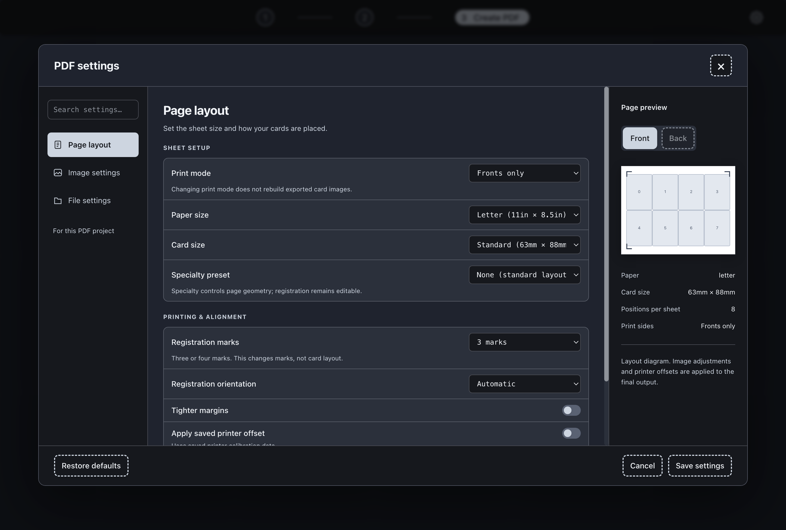

# Development Environment Setup

If you're starting with a fresh install of your operating system, follow these steps to set up your development environment:

## 1. Install Python

- Download Python from the official website: https://www.python.org/downloads/
- Run the installer and **check the box to add Python to your PATH**.
- Verify installation:
   ```powershell
   python --version
   ```

## 2. Install Node.js

- Download Node.js (LTS version recommended) from: https://nodejs.org/
- Run the installer and follow the prompts.
- Verify installation:
   ```powershell
   node --version
   npm --version
   ```

Once Python and Node.js are installed, continue with the project setup steps below.
# Silhouette Card Maker GUI

- Node.js 22 or newer is required.
  With nvm, run `nvm install` and `nvm use` from the project root before you install dependencies or run a build.
- Python (v3.10+ recommended)
- All Python dependencies listed in the project root `requirements.txt`
## 1. Install Python

- **Windows:** Download Python from the official website: https://www.python.org/downloads/
   - Run the installer and **check the box to add Python to your PATH**.
- **Linux/Mac:** Install via your package manager or download from the website.
   - Ubuntu/Debian:
      ```bash
      sudo apt update && sudo apt install python3 python3-pip
      ```
   - Mac (Homebrew):
      ```bash
      brew install python3
      ```
- Verify installation:
   ```powershell
   python --version
   ```
   ```bash
   python3 --version
   ```

## Setup

   npm install
   ```

2. **Install Python dependencies**
## 2. Install Node.js

- **Windows:** Download Node.js (LTS version recommended) from: https://nodejs.org/
   - Run the installer and follow the prompts.
- **Linux/Mac:** Install via your package manager or download from the website.
   - Ubuntu/Debian:
      ```bash
      sudo apt update && sudo apt install nodejs npm
      ```
   - Mac (Homebrew):
      ```bash
      brew install node
      ```
- Verify installation:
   ```powershell
   node --version
   npm --version
   ```
   ```bash
   node --version
   npm --version
   ```
   ```powershell
   cd ..
   python -m pip install -r requirements.txt
   ```

3. **Build the Python executables**
   Required for PDF generation in the GUI, including packaged Windows builds.

   **Windows:**
   ```powershell
   .\build_entrypoints.bat
   ```

   **macOS/Linux:**
   ```bash
   ./build_entrypoints.sh
   ```

   This creates the top-level Python entrypoint executables in the project root,
   including `pdf_worker.exe` on Windows (`pdf_worker` on macOS/Linux). The GUI
   uses this persistent worker for both PDF creation and offsets.

   From the project root, stage the executables for Electron:
   ```powershell
   npm run copy:entrypoints
   ```

   To build the executables, stage them, and package the app for your current OS:
   ```powershell
   npm run build-all
   ```
   Releases are written to `GUI/dist`: installer/ZIP on Windows, DMG/ZIP on
   macOS, and AppImage/tar.gz on Linux. Build on the target OS and architecture;
   PyInstaller executables are native binaries and cannot be reused across OSes.
   macOS and Linux builds use the host architecture. Packaging checks that all
   required executables exist in `GUI/bin` before creating a release.

   `npm test` checks entrypoint discovery and paths for all three platforms.
   After building the worker, `python -m unittest discover -s tests` verifies
   PDF creation, offsets, Unicode paths, and worker reuse. The PDF worker
   compatibility workflow runs these checks on Windows, macOS, and Linux.

   The build script will:
   1. Install/upgrade pip
   2. Install required Python packages
   3. Install PyInstaller
   4. Build a standalone executable
   5. Clean up temporary build files

## Running the GUI

1. **Start the Electron app**
   ```powershell
   cd GUI
   npm run start
   ```

The GUI will open in a new window. You can generate PDFs, view images, and use all available features.

### Create PDF settings

Open **PDF settings** on the Create PDF screen. The preferences window has Page layout, Image settings, and File settings categories, a search field, and a page preview. The controls use the worker's available paper, card, and specialty layouts. Use the destination controls to choose a PDF file or a folder for PNG pages. Crop values accept `mm`, `in`, or `%`; a bare crop value means percent. Extension values accept `mm`, `in`, or layout pixels; a bare extension value means pixels. PPI must be a whole number. **Restore defaults** changes the draft to CLI defaults and managed image folders. **Save settings** applies the draft. **Cancel**, the close button, or Escape discards the draft. Settings stay in the current app session.

Run `npm run test:pdf-settings-ui` from the repository root to test the screen with a real Electron window and frozen worker. The test uses temporary source folders and output.



Changing between fronts only and fronts and backs changes PDF creation. It does not rebuild card images already exported from a deck list. Source folder controls also change the image lists and file actions on this screen.

## Development Notes
- Reuse UI components from `GUI/shared/` and `GUI/styles/tailwind.css`. Static buttons use `paper-button` with optional `paper-button--compact` or `paper-button--icon`. For buttons created in JavaScript, use `createButton({ text, size, onClick })` from `GUI/shared/button.js`. Native button semantics, disabled states, focus, hover, and pressed styling stay shared.
- Create PDF settings and layout diagrams load from `GUI/shared/pdfCatalog.json`, without waiting for Python. Both native entrypoint build scripts regenerate the catalog from the Python CLI and layout engine. After changing creation options or layouts, run `python scripts/export_pdf_catalog.py` with the project dependencies installed. The Python catalog parity test checks that the bundled data matches the engine.
- The Electron app communicates with Python via IPC and can run either the script or the compiled executable.
- For advanced features, see the main project README and the scripts in the root directory.

## Troubleshooting
- If you see errors about missing Python modules, ensure you installed all dependencies from `requirements.txt`.
- If PDF creation or offsets report a missing `pdf_worker.exe`, rebuild and stage
  the Python executables as shown above, then rebuild the installer. Older
  Windows builds could skip this worker because their entrypoint discovery
  only recognized single-quoted `__main__` guards.
- For Windows, use PowerShell or Command Prompt. For Mac/Linux, adapt commands as needed.

## Application updates and releases

The supported release targets are Windows x64 NSIS installer and ZIP, macOS x64
and arm64 DMG and ZIP, and Linux x64 AppImage and tar.gz. Builds run on the
matching operating system and architecture because the bundled Python tools are
native executables. macOS packages are currently unsigned; updates on macOS are
installed manually from the release page. Windows ZIP and Linux tar.gz builds
also require manual installation. In-app installation is intended for Windows
NSIS and Linux AppImage packages.

Earlier versions do not contain the update service. Users upgrading from one of
those versions must download and install the first updater-enabled release
manually. Later releases can be discovered by the app. Automatic checks are
enabled by default. Settings shows the installed version, last successful check,
automatic-check toggle, manual **Check for updates** button, and current status.
The first automatic check runs 12 seconds after launch, followed by checks every
24 hours. **Later** hides a version's notice for 24 hours; the update remains
available in Settings. Downloads and **Restart and install** always require the
user to choose them.
The release feed is explicitly configured for
[`caseycrocamo/silhouette-card-maker`](https://github.com/caseycrocamo/silhouette-card-maker).
Application identity and Electron user-data location must remain stable so
images, decklists, calibration, offsets, and PDFs stay in the user's data area.

### Building and checking a release

Set `GUI/package.json`'s version and push the matching `v<version>` tag, such as
`v1.2.0`. The release workflow rejects a tag that does not match that package
version. It builds and tests every supported target, verifies the generated
metadata, hashes, blockmaps, and target artifacts, uploads the full set to a
draft GitHub release, and publishes only after verification succeeds. CI uses
the repository's `GITHUB_TOKEN`; public clients need no embedded token. A manual
workflow dispatch runs the builds and checks only and does not create or publish
a release.

For a local build, install the GUI dependencies with `npm ci`, build the CSS,
build and stage native Python entrypoints from the repository root, then run an
appropriate command from `GUI` on the matching platform, such as
`npx electron-builder --win --x64 --publish never`. Use `--mac` or `--linux` for
those targets, and `--arm64` for Apple silicon. Use the release verifier against
the resulting `GUI/dist` folder, providing the package version and platform
list. Never reuse Python binaries built for a different OS or architecture.

Release artifacts are unsigned today, so checksum validation establishes file
integrity but does not verify publisher identity. Apple Developer ID signing
and notarization are not configured. Before announcing the first updater-enabled
release, validate a real version N-to-N+1 installation on Windows NSIS and
Linux AppImage using an isolated test feed. The CI artifact checks are not a
substitute for that packaged upgrade test. Also confirm ordinary quit, active
PDF work, checksum failure, download failure, and data preservation on those
targets; test the manual replacement flow on macOS and archive distributions.

On Windows, after building the application, run the Electron UI/IPC smoke and
the real updater download smoke from the repository root with:

```powershell
node GUI/node_modules/electron/cli.js tests/update-ui-smoke.cjs
node GUI/node_modules/electron/cli.js tests/update-download-smoke.cjs
```

The download smoke reads the installer named by `GUI/dist/latest.yml`, uses an
isolated loopback feed and cache, checks the real updater's SHA-512 validation,
and never launches the installer. The manual-flow and full N-to-N+1 install
checks remain separate release qualification steps.

---

For more help, see the main project README or contact the project maintainer.

### Pokémon and shared card lists

Choose Pokémon on Home to open a Limitless deck list. Paste lines in the form `3 Charcadet SSP 32`. Category headers and blank lines are allowed. Each card needs a quantity, name, set code, and card number. Pokémon TCG and Pocket use the same input area. Review errors and retry missing images before selecting **Next: Create PDF**.

Pokémon starts with card fronts only. To print a common back, enable backs on the PDF page and choose your own image. Pocket image sources can have lower print quality. Exact printings that cannot be found produce an error instead of substituting another set.

All games use the same buttons on Home. Choose Magic: The Gathering, then choose card images or Text translation in the popup. The current numbered navigation stays in place. Each game's draft and workflow are saved separately for the current app session.

### Choose an MTG printing

Click an MTG card image to open the printing side panel. You can also focus the image and press Enter or Space. The italic reminder at the top of the page explains this action. Each printing has its own image, set name, set code, collector number, and treatment. Search by set or collector number, or sort the list. Select a row to inspect its larger preview. Cards with two faces have Front and Back controls.

The panel starts with 25 printings. Select **Load more** to show the next batch. The link disappears when no more printings remain. Change the batch size under **Settings → Card printing → Printings per load**. Save a whole number from 1 to 200; it applies the next time you open the selector and stays saved when the app closes.

A checkmark shows the choice in the panel. Select **Use this printing** to apply it to that card entry. The quantity stays the same. **Cancel**, **Close**, and Escape keep the current printing. If printing data or an image fails to load, use its retry action.

MTG card images are cached in memory for the app session. The printing panel, deck preview, and image export share each downloaded image. Changing pages keeps the cache. Closing all app windows or quitting clears it. This cache does not write files to disk.

The card worker runs separately from the PDF worker. Development can use the project virtual environment. Packaged apps require the `card_worker` executable (or `card_worker.exe` on Windows) in `GUI/bin`, with no local Python installation. The standard entrypoint build discovers this worker. Build and copy entrypoints before making a release.

### CLI feature controls

Home lists all supported games together. Select a game, then choose its deck format,
image source, and print setup in the options popup when choices are available.
The card list keeps these controls in the **Options** popup. Cancel or Escape
discards changes. Each format keeps its own draft and choices. Imports stage downloaded images in the card cache. Use the
existing export or **Next: Create PDF** action to write print images. A failed
import does not clear existing print images.

**Tools → Cutting templates** creates DXF files from named or custom sizes. Select
a DXF destination for one template, or an output folder for a batch. Saved custom
sizes and layouts are stored in the app data folder and become available in PDF
settings. The app keeps bundled layout definitions unchanged. On Windows, the Studio section also converts DXF files to `.studio3` files.
It supports one file, batches, missing outputs, a preview without automation,
automation calibration, and Stop. Studio automation controls the mouse and
keyboard and needs the stated screen size. macOS and Linux show manual steps.

**Settings → Printer offsets** includes rotation, per-run overrides, PPI, and an
output PDF path. Blank overrides use saved values; applying a PDF does not save
those overrides. Positive X moves right, positive Y moves up, and positive rotation
turns clockwise in the back-page frame. Calibration sheets can be generated for
selected configured paper sizes. Generated sheets are stored in a writable folder,
separate from the supplied calibration PDFs.

After changes to Python workers, rebuild and stage the entrypoints before running
the packaged app. `card_worker` includes all plugin modules. `template_worker` is
required for Tools. Existing installed binaries do not gain features from source
changes alone.


For the new controls, activate the project Python environment with pytest installed,
then run `npm run test:gui-backends` and `npm test`. Use
`npm run test:game-plugins-ui`, `npm run test:template-tools-ui`, and
`npm run test:printer-calibration-ui` for the page checks. Set
`CARD_MAKER_SMOKE_SOURCE_WORKER` to the project Python executable for the printer
check. `npm run test:gui-parity-ui` checks the full custom-template-to-calibration
path with isolated source workers; it uses `venv/bin/python` unless that environment
variable is set. Match Electron and Python architectures on macOS.


Game option menus load from the bundled `GUI/shared/gameCatalog.json`. Opening a
menu or a blank card list does not start the card worker. Python starts when card
lookup or import is needed. Both entrypoint build scripts refresh the catalog.
After changing `plugins/gui_game_metadata.py`, run
`python scripts/export_game_catalog.py`; the catalog parity test checks the result.


### MTG imports and selection rules

Choose MTG, then use Options to select the input format. The GUI supports simple,
MTGA, MTGO, Archidekt, Deckstats, Moxfield, CubeCobra CSV, Scryfall JSON, MPCFill
XML, and deck URLs. File formats keep their source for retry; use Open another
deck file to replace it. Custom art keeps its original image and paired back.
Its printing picker is disabled because it has no Scryfall printing identity.

MTG selection preferences support ignoring supplied printing data, older sets,
ordered preferred sets and languages, excluded sets, showcase, extra art,
Universes Beyond, and related tokens. Apply preferences, then search again.
Supplied printing data wins unless ignored. Prefer and exclude Universes Beyond
cannot both be selected. Failed-entry retries keep successful results.

### Translation files and outputs

Text translation can open Markdown for editing, or use pasted text. Choose the
PDF destination and any configured paper size, including custom sizes saved in
Tools. Quality 0 is supported. Generation uses the editor text, preserves the
source file, and shows a link to the actual PDF. A failed conversion preserves
an existing output PDF and removes temporary files.

Additional checks: `npm run test:mtg-imports-ui`,
`npm run test:text-translation-ui`, and `npm run test:studio-tools-ui`.
Real Studio conversion and calibration still need acceptance checks on Windows
with Silhouette Studio installed. Source-worker tests do not prove native release
behavior; rebuild helpers before packaging.


Run native helper parity checks with `CARD_MAKER_PARITY_BIN_DIR` set to a folder
containing the four built helpers, then run `npm run test:gui-frozen`. The tests
remove Python from the helper execution path and use temporary input/output
folders. Without that variable, these checks are skipped.
